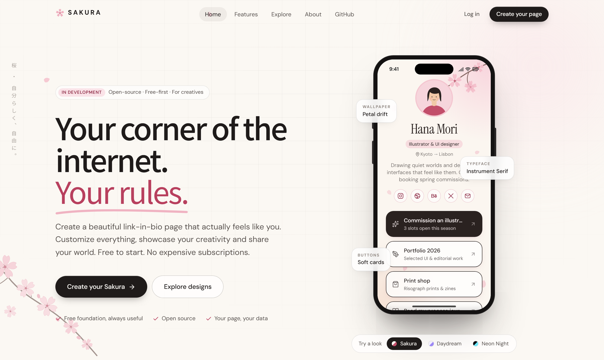
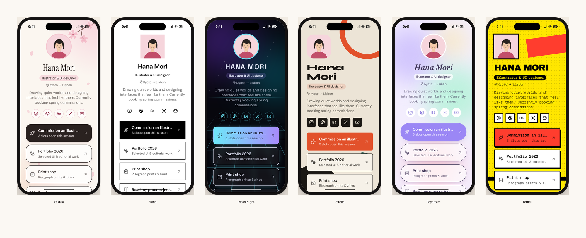
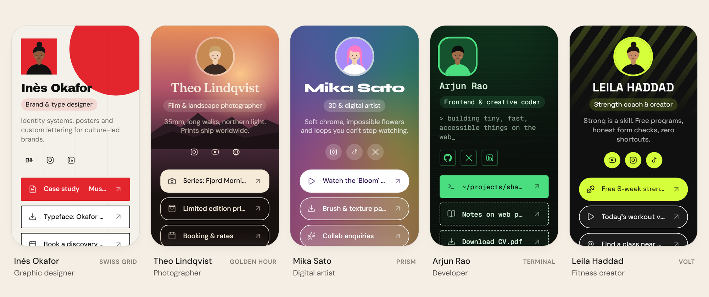
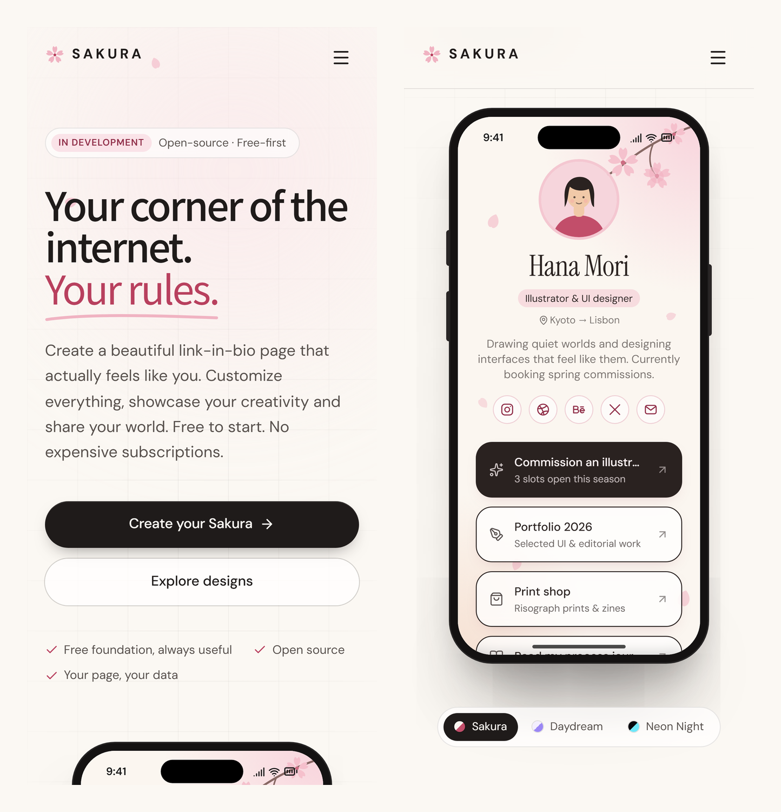

<div align="center">


# SAKURA &nbsp;<sub><sup>桜</sup></sub>

### Your space. Your style. Your links.

A free-first, open-source **link-in-bio platform** for designers, artists, photographers,<br/>
developers and creators — beautiful personal pages without expensive subscriptions.

<br/>

[](https://github.com/nglsree/SAKURA/actions/workflows/ci.yml)

[](LICENSE)


**[Overview](#overview)** &nbsp;·&nbsp;
**[Themes](#themes)** &nbsp;·&nbsp;
**[Features](#features)** &nbsp;·&nbsp;
**[Quick start](#quick-start)** &nbsp;·&nbsp;
**[Deploy](#deploy)** &nbsp;·&nbsp;
**[Contribute](#contributing)**

<br/>



</div>

<br/>

> [!NOTE]
> **Sakura is in early development.** This repository currently contains the **landing page** — a fully static site.
> Profile creation, accounts and publishing are not live yet, and the page says so honestly instead of faking them.

<br/>

<a id="overview"></a>

## 🌸 What is Sakura?

Most link-in-bio pages look the same. Sakura is built for people whose page *is* their portfolio —
where the fonts, colors, wallpaper and buttons should feel like **you**, not like a template.

<table>
<tr>
<td width="33%" valign="top">

**🎨 Creative freedom**<br/>
<sub>Wallpapers, typefaces, palettes, button shapes, icon styles and layouts — every piece is meant to be changed.</sub>

</td>
<td width="33%" valign="top">

**🌱 Free at the root**<br/>
<sub>A genuinely useful free foundation. Any future supporter plan is optional — never a paywall on the basics.</sub>

</td>
<td width="33%" valign="top">

**🤝 Open by design**<br/>
<sub>Built in the open so designers and developers can contribute themes, code, accessibility and translations.</sub>

</td>
</tr>
</table>

**Made for** graphic & UI/UX designers · digital artists · illustrators · photographers · developers · content creators · freelancers

<br/>

<a id="themes"></a>

## ✿ One profile, six personalities

The same profile — same name, same links — rendered with six different themes. Themes are just data (CSS variables), so anyone can design one.

<p align="center">
  
</p>

| Theme | Typography | Wallpaper | Buttons |
| :-- | :-- | :-- | :-- |
| **Sakura** | Instrument Serif + DM Sans | Petal drift | Soft cards |
| **Mono** | DM Sans | Solid white | Hairline outline |
| **Neon Night** | Space Grotesk | Horizon grid | Glow glass |
| **Studio** | Syne + DM Sans | Sand + shapes | Row list |
| **Daydream** | Fraunces italic | Soft-focus blobs | Bubble pills |
| **Brutal** | Archivo Black + Geist Mono | Halftone yellow | Hard-shadow blocks |

<details>
<summary><b>See how a theme is defined</b></summary>
<br/>

Every preview is rendered by one component (`ProfileCard`) from a theme object in [`src/profile/themes.ts`](src/profile/themes.ts):

```ts
export const sakura: ProfileTheme = {
  id: "sakura",
  name: "Sakura",
  wallpaper: "petals",
  align: "center",
  avatarShape: "circle",
  vars: v({
    "--pf-bg": "#fbf6f0",
    "--pf-fg": "#2a2220",
    "--pf-accent": "#2a2220",
    "--pf-radius": "18px",
    "--pf-font-display": SERIF,
    // …colors, borders, shadows, icon styles
  }),
};
```

Copy a theme, change the values, add it to `showcaseThemes` — done.

</details>

<br/>

## 🎭 Made for every kind of creator

<p align="center">
  
</p>

<p align="center"><sub>Fictional creators and example links, each with its own visual personality.</sub></p>

<br/>

<a id="features"></a>

## ✨ Features

Honest labels: **MVP** = scoped for the first public release · **Planned** = on the roadmap. Nothing here is claimed to be live yet.

<table>
<tr><th align="left">Feature</th><th align="left">Status</th><th align="left">Feature</th><th align="left">Status</th></tr>
<tr><td>🖼️ Custom wallpapers & backgrounds</td><td><code>MVP</code></td><td>📱 Responsive mobile layouts</td><td><code>MVP</code></td></tr>
<tr><td>🔤 Custom fonts & colors</td><td><code>MVP</code></td><td>🌗 Dark & light modes</td><td><code>MVP</code></td></tr>
<tr><td>🔣 Changeable social icons</td><td><code>MVP</code></td><td>🗂️ Easy link management</td><td><code>MVP</code></td></tr>
<tr><td>🔗 Custom link cards & buttons</td><td><code>MVP</code></td><td>🌐 Shareable profile URLs</td><td><code>MVP</code></td></tr>
<tr><td>👤 Profile pictures & avatars</td><td><code>MVP</code></td><td>♾️ Unlimited creative freedom</td><td><i>Planned</i></td></tr>
<tr><td>🧩 Custom themes & layouts</td><td><i>Planned</i></td><td>🖌️ Portfolio & project showcases</td><td><i>Planned</i></td></tr>
</table>

<br/>

## 📱 Designed phone-first

<table>
<tr>
<td width="46%"></td>
<td valign="middle">

Link-in-bio pages live on phones, so the landing page does too:

- Fully responsive — desktop, tablet and mobile
- Full-screen mobile navigation
- Interactive phone preview with live theme switching
- Subtle scroll animations that respect **reduced motion**
- Accessible contrast, keyboard focus states and skip link
- No images for wallpapers or avatars — all CSS & SVG, crisp at any density

</td>
</tr>
</table>

<br/>

## 🧭 Principles

| | |
| :-- | :-- |
| **Freedom** over restrictions | **Customization** over templates |
| **Affordable** over expensive subscriptions | **Open-source** development |
| **Ownership & portability** for creators | **Honesty** — no fake sign-ups, analytics or invented prices |

<br/>

## 🛠 Tech stack

| Layer | Choice |
| :-- | :-- |
| Framework | [React 19](https://react.dev) + [TypeScript](https://www.typescriptlang.org) |
| Build | [Vite 8](https://vite.dev) — static output in `dist/` |
| Styling | [Tailwind CSS v4](https://tailwindcss.com) + CSS variables for theming |
| Motion | [Framer Motion](https://motion.dev) |
| Icons | [Lucide](https://lucide.dev) + hand-drawn SVG brand glyphs |
| Typography | **DM Sans** (primary) · **Noto Sans JP** (editorial headings & Japanese accents) |
| Hosting | [Cloudflare Pages](https://pages.cloudflare.com) (free tier) — no backend, no API keys |

<br/>

<a id="quick-start"></a>

## 🚀 Quick start

> Requires **Node.js 20.19+ or 22.12+** and npm.

### Installation

```bash
git clone https://github.com/nglsree/SAKURA.git
cd SAKURA
npm install
```

### Development

```bash
npm run dev        # → http://localhost:5173 (hot reload)
```

### Production build

```bash
npm run build      # type-check + static build → dist/
npm run preview    # serve dist/ locally to check it
```

| Command | What it does |
| :-- | :-- |
| `npm run dev` | Start the dev server with hot reload |
| `npm run build` | Type-check and build the static site to `dist/` |
| `npm run preview` | Serve the production build locally |
| `npm run typecheck` | Type-check only |

<details>
<summary><b>⚙️ Configuration (optional environment variables)</b></summary>
<br/>

Copy `.env.example` to `.env`. These are **public**, build-time values — never put secrets in `VITE_*` variables.

| Variable | Default | Purpose |
| :-- | :-- | :-- |
| `VITE_GITHUB_URL` | `https://github.com/nglsree/SAKURA` | Repository linked from the site (override for forks) |
| `VITE_CONTACT_EMAIL` | `hello@sakura.example` *(placeholder)* | Footer contact address |

Still to replace once they exist: the domain `sakura.example` in `index.html`, `public/robots.txt` and `public/sitemap.xml`, and a 1200×630 `public/og-image.png` for social previews.

</details>

<details>
<summary><b>🗂 Project structure</b></summary>
<br/>

```
SAKURA/
├─ .github/workflows/ci.yml     # build check on every push / PR
├─ docs/screenshots/            # images used in this README
├─ public/                      # favicon, robots, sitemap, Cloudflare _headers
├─ src/
│  ├─ components/
│  │  ├─ sections/              # Navbar, Hero, ThemeShowcase, Features, HowItWorks,
│  │  │                         # WhySakura, CreatorShowcase, OpenSource, Pricing, FinalCTA, Footer
│  │  └─ ui/                    # Button, Logo, Reveal, InfoDialog, BrandIcons, decorations
│  ├─ profile/                  # the profile renderer used by every preview
│  │  ├─ themes.ts              # themes = plain data (CSS variables)
│  │  ├─ profiles.ts            # fictional example creators
│  │  ├─ ProfileCard.tsx        # renders a profile from a theme
│  │  ├─ Wallpaper.tsx          # CSS/SVG wallpapers
│  │  ├─ Avatar.tsx             # illustrated avatars
│  │  └─ PhoneFrame.tsx
│  ├─ config.ts                 # URLs and nav items
│  ├─ index.css                 # design tokens + typography
│  └─ App.tsx
├─ index.html                   # SEO metadata, font loading
└─ vite.config.ts
```

</details>

<br/>

<a id="deploy"></a>

## ☁️ Deploy

Sakura deploys for free to **Cloudflare Pages** straight from this repository — no tokens or secrets needed.

1. [dash.cloudflare.com](https://dash.cloudflare.com) → **Workers & Pages** → **Create** → **Pages** → **Connect to Git** → choose `SAKURA`
2. Build settings:

   | Setting | Value |
   | :-- | :-- |
   | Framework preset | `Vite` |
   | Build command | `npm run build` |
   | Output directory | `dist` |
   | Environment variable | `NODE_VERSION` = `22` |

3. **Save and Deploy** → your site is live at `https://<project>.pages.dev`

Every push to `main` redeploys automatically and pull requests get preview URLs. [`public/_headers`](public/_headers) adds long-term asset caching and basic security headers.

<details>
<summary><b>🔗 Connect a custom domain</b></summary>
<br/>

1. Pages project → **Custom domains** → **Set up a custom domain**
2. Enter your domain (e.g. `sakura.yourdomain.com` or the apex `yourdomain.com`)
3. If DNS is on Cloudflare, the record is created automatically — otherwise add the `CNAME` shown (pointing to `<project>.pages.dev`). Apex domains need Cloudflare nameservers.
4. HTTPS is issued automatically once DNS resolves
5. Replace `sakura.example` in `index.html`, `public/robots.txt` and `public/sitemap.xml`, then push

</details>

<br/>

## 🗺 Roadmap

- [x] Landing page with live theme switcher
- [x] Typography & brand system (DM Sans + Noto Sans JP)
- [x] Repository, CI build check
- [ ] Public deployment on Cloudflare Pages
- [ ] Custom domain
- [ ] Profile editor (MVP)
- [ ] Accounts & shareable profile URLs
- [ ] Community themes

<br/>

<a id="contributing"></a>

## 🤝 Contributing

Contributions of every kind are welcome — **themes, code, accessibility, writing and translations**.

1. Fork the repo and create a branch: `git checkout -b feature/my-theme`
2. Make your change and run `npm run build` (must pass)
3. Open a pull request with a short description — and a screenshot for visual changes

See [**CONTRIBUTING.md**](CONTRIBUTING.md) for guidelines. The golden rule: *never claim a feature works before it ships.*

<br/>

## 📄 License

[MIT](LICENSE) © 2026 The Sakura contributors

<br/>

<div align="center">


<sub><b>SAKURA</b> · あなたの場所。あなたのスタイル。あなたのリンク。</sub><br/>
<sub>Built with creativity. Open to everyone.</sub>

</div>
